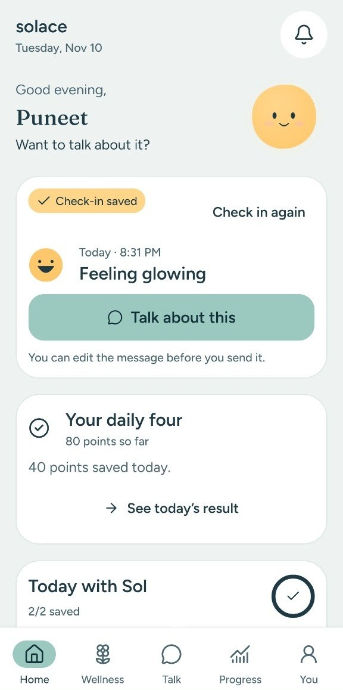
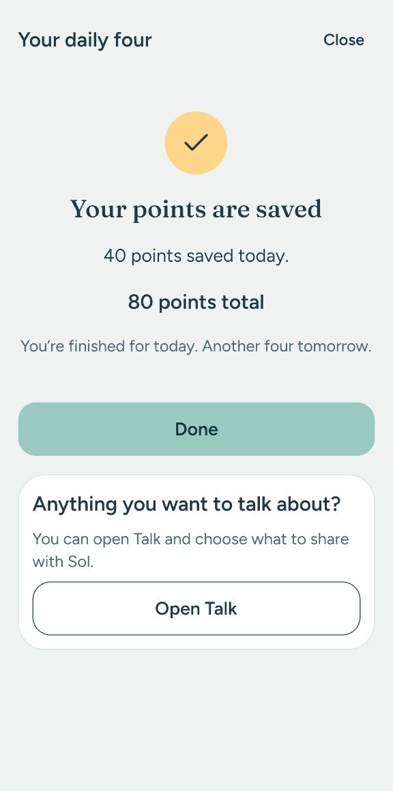
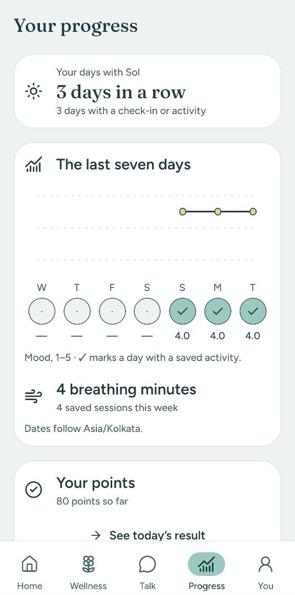
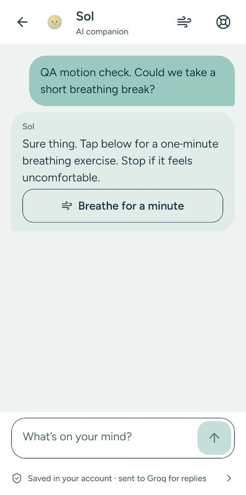
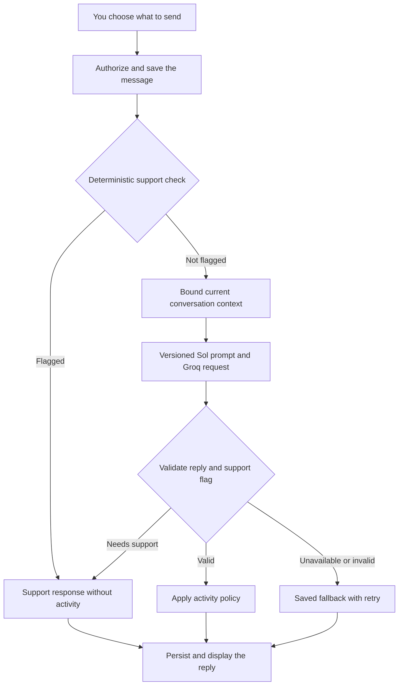
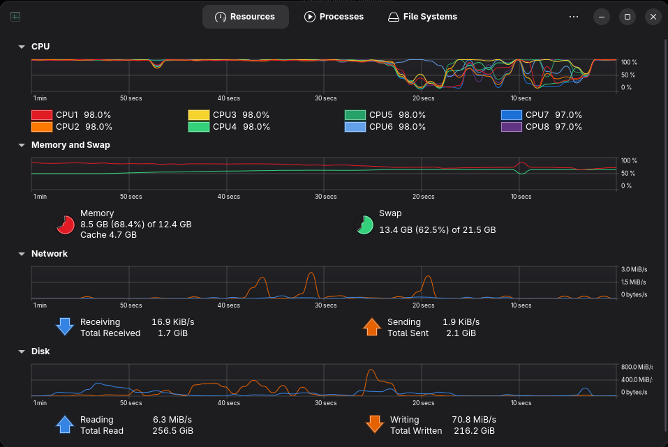

# Solace AI


**My personal project: an Android wellness app for talking with Sol, checking in, and taking a break.**

I'm [Punith Moger](https://github.com/mgr-punith). I built Solace's Android app, API, and database, then kept improving it through real phone checks. **Sol is the AI companion at the center of it.** You can talk through your day, ask it to listen, or take a breathing break from a conversation. Check-ins, daily questions, and progress give you a few other ways to use the app.

[Download Android APK](https://drive.google.com/file/d/1WgamEj4WnLPNyVg7xF2_Wu5IzA6QZOvQ/view?usp=sharing) · [Watch the walkthrough](https://drive.google.com/file/d/16QlPT8gkgczPtxabPB8WtEDlsXR6eIsj/view?usp=sharing) · [APK and video folder](https://drive.google.com/drive/folders/1j8RrbAC4PEYAw3HPHSGQNZnoNHrWJofu?usp=sharing)

[](https://github.com/mgr-punith/solace-ai/actions/workflows/verify.yml) [](LICENSE)

> **The first request can be slow.** I host the backend on Render's free tier. It sleeps after 15 minutes without traffic and takes about a minute to wake, sometimes longer. If opening the app, signing in, or getting a reply times out, wait a moment and retry. See [startup help](#startup-and-troubleshooting).

Sol is an AI wellness companion, not a therapist or a medical device. It can make mistakes and does not provide emergency monitoring or professional care.

[App interface](#app-interface) · [AI chat and response design](#ai-chat-and-response-design) · [User guide](#user-guide) · [Build history](#build-history) · [Engineering practices](#engineering-practices) · [Run the project](#run-the-project)

## App interface

I kept the screens quiet: sea-glass colors, Fraunces headings, Figtree body text, and Sol's face. You can choose Light or Dark, or let Auto follow the time of day. Most of the motion is in Sol, breathing, and chat; the app also supports Reduce Motion.

<p>
  
  
  
</p>

Home, Daily Four, and Progress on Android. I cropped the system bars and kept the app content unchanged. The [chat screenshot](#ai-chat-and-response-design) shows Sol's reply and its activity button.

The [6-minute walkthrough](https://drive.google.com/file/d/16QlPT8gkgczPtxabPB8WtEDlsXR6eIsj/view?usp=sharing) takes you through onboarding, a check-in shared into chat, Daily Four completion, breathing, and the rest of the app.

## AI chat and response design

I spent the most time on how Sol replies. If you say “just listen,” it should let you talk. If a breathing break didn't help, it should accept that. I used prompt revisions, server-side rules, and tests to work toward those responses.



In this saved test chat, I asked for a breathing break. Sol replied with a **Breathe for a minute** button. Tapping it opens the exercise; you still choose when to start. The line below the composer tells you that Groq receives messages for replies.

**An example I put in the prompt to show the intended tone** (illustrative, not a recorded reply):

> **You:** I keep replaying that awkward thing I said in the meeting. I just want to vent.
>
> **Sol:** Go ahead. Tell me what happened in the meeting; I won't jump in with advice.

The [current prompt](apps/api/src/ai/prompts/sol-v2.ts) asks for short, specific replies: often one to three sentences and one useful question at most. I removed stock reassurance, therapy jargon, and exaggerated praise from the guidance. Longer answers are fine when needed. The model can still miss the mark, so the prompt is only one part of the implementation.

| Decision                                      | How it helps the conversation                                                                                                                                                                                                                                               |
| --------------------------------------------- | --------------------------------------------------------------------------------------------------------------------------------------------------------------------------------------------------------------------------------------------------------------------------- |
| **Use relevant conversation context**         | Include up to 20 recent messages within a 12,000-byte UTF-8 conversation budget, plus the fixed prompt. Do not infer a profile or access unshared mood notes.                                                                                                               |
| **Respect “just listen” and declined advice** | The prompt says to stay with the conversation after a decline or an exercise that did not help. The server also blocks activity offers on consecutive replies.                                                                                                              |
| **Ground suggestions in the app**             | The model can suggest breathing or an affirmation. It receives the actual breathing rhythms and durations from shared app constants. It cannot change settings or start a session.                                                                                          |
| **Validate a structured reply**               | Groq returns `content`, `activity`, and `needsSupport`. Zod checks the object and a 1,600-character reply limit. The app maps allowed activities to its own routes; the model supplies no navigation URL.                                                                   |
| **Use layered support handling**              | Deterministic checks run before the provider call. A model support flag also selects the support response. Crisis and failed replies cannot attach an activity. This reduces some failure modes; it is not complete crisis detection.                                       |
| **Keep failures recoverable**                 | A 45-second provider deadline covers at most two attempts. Specific rate-limit, server, and Groq format errors get a bounded retry. Invalid or incomplete output becomes a saved fallback with a retry action.                                                              |
| **Evaluate behavior beyond the happy path**   | The synthetic evaluation script covers anxiety, sadness, anger, loneliness, listening, declined activities, disappointing practice results, app controls, crisis cases, and prompt injection. Automated tests mock the provider; live evaluations need an explicit command. |

The configured model is **`openai/gpt-oss-120b` through Groq**, with low reasoning effort, a 1,024-token completion ceiling, and final text only. A provider interface keeps transport details out of conversation logic. VyceAi remains an explicit alternative; there is no automatic switch that sends a conversation to another provider after a failure.



One useful lesson came from a failed follow-up after an activity suggestion. The model saw plain-text assistant history while I was asking it to return JSON. A matched test reproduced the format error. I changed the history to use the same structured reply format and added a targeted retry for `json_validate_failed`. The affected synthetic cases then passed. I kept the [investigation](docs/decisions/0010-sol-activity-replies.md) in the repo because it explains the fix better than “improved AI responses.”

## User guide

### Install and sign in

1. Open the [APK download](https://drive.google.com/file/d/1WgamEj4WnLPNyVg7xF2_Wu5IzA6QZOvQ/view?usp=sharing) on an Android phone and download **`solace-puneet.apk`**. The [shared folder](https://drive.google.com/drive/folders/1j8RrbAC4PEYAw3HPHSGQNZnoNHrWJofu?usp=sharing) contains the same file and the walkthrough.
2. Open the downloaded file. If Android asks, allow installation from the browser or file manager you used, then tap **Install**. You can turn that permission off afterward.
3. Open **Solace**, go through the introduction and privacy information, and tap **Sign in with Google**. The project's Google sign-in is published for other Google accounts.
4. Choose your Google account. Home shows your greeting and check-in. If startup takes a while, give Render time to wake, then use the retry action.

This is a standalone preview APK: you do not need a laptop, Expo Go, or a development server to use it. Account features and AI replies need an internet connection. Google sign-in requires Google Play services.

| Download detail                 | Current shared build               |
| ------------------------------- | ---------------------------------- |
| Version                         | `0.1.0` · Android version code `1` |
| Built                           | 9 November 2026                    |
| Size                            | 51.0 MB · 51,011,942 bytes         |
| Device architecture             | ARM64 (`arm64-v8a`)                |
| Android minimum declared by APK | Android 7.0 / API 24               |
| Device used for hands-on checks | vivo V2168, Android 14             |
| Package                         | `com.puneet.solace`                |

<details>
<summary>Verify the downloaded APK</summary>

The shared file matches the signed local preview build. Its SHA-256 is:

```text
8867dd9de2918bb9738c18a0cdfff51372014897db55ac0de59743a7c837d69c
```

On Linux, run `sha256sum solace-puneet.apk` in the download directory and compare the result. A different file or a later build will have a different hash.

</details>

### Find your way around

| Tab          | What you can do                                                                                                  |
| ------------ | ---------------------------------------------------------------------------------------------------------------- |
| **Home**     | Save a mood check-in, open Your daily four, choose a suggested activity, and see today's words.                  |
| **Wellness** | Start a breathing session, read affirmations, open daily questions, or manage reminders.                         |
| **Talk**     | Start a conversation with Sol, continue a saved chat, or delete one.                                             |
| **Progress** | See check-in history, seven days of mood, breathing minutes, participation points, and days with Sol.            |
| **You**      | Change appearance, manage reminders, revisit privacy, open saved affirmations, sign out, or delete your account. |

### Check in and choose what to share

On **Home**, choose **Heavy, Low, Okay, Good, or Glowing**. Add feelings and a note if you want, then tap **Save check-in**. You can save another check-in later; Progress keeps the history.

**Talk about this** opens a chat with an editable draft based on that check-in. Read it, change or remove details, then tap the send arrow when ready. Sol only receives that draft after you send it. Saving a check-in alone does not share it with the AI provider.

Home also offers a suggested activity with a reason and duration, plus **Other ideas**. These choices use curated rules based on today's mood and feelings; they do not read private notes or call a model. **Today with Sol** has two completion markers: a saved check-in, and a saved breathing session or affirmation read. After both, **More ideas for today** keeps further activities available.

### Talk with Sol

Open **Talk → New conversation**, type your message, and tap the send arrow, labelled **Send message** for screen readers. Sol can listen, ask a follow-up, or answer a question. You can say that you want to vent or that you do not want advice.

- Continue a saved conversation from Talk to keep its context. Start a new conversation for a separate chat.
- If a reply offers **Breathe for a minute** or **Read today's words**, tap it to open that activity. You choose whether to start or save anything.
- Return to the conversation after an activity. A prepared reflection remains editable and waits for you to send it.
- If a reply fails, use **Retry** on that turn. The saved request keeps a retry from duplicating your message. An unconfirmed send has its own retry state.
- Use the delete control beside a conversation and confirm to remove the conversation and its messages.

The provider notice in chat identifies the service receiving messages for replies. The current deployment uses Groq. See [how the responses work](#ai-chat-and-response-design) below.

### Answer Your daily four

Open **Your daily four** from Home or Wellness. Answer the questions about rest, energy, focus, and connection; **Prefer to skip** is a valid choice. Use Back to change an answer, review the four choices, then tap **Finish and earn 40 points**.

You earn **40 participation points once per local day**, regardless of your answers. Points do not score your mental health and have no monetary value. Seven curated question sets rotate by date. Closing and reopening the modal resumes the draft during the app session; unsaved answers do not survive app termination.

The server validates the answers and stores the completion and points, not the answers. Your saved total appears in Progress and remains after reopening the app. Repeating a save does not award more points.

### Breathe and read affirmations

Open **Wellness → Take a breathing break**. The default is one minute of Coherent breathing. Tap **Customize** to choose **Coherent, Box, or 4–7–8** and **1, 3, or 5 minutes**, then start. Follow Sol's pacing; pause or end whenever you need. Leaving the foreground pauses the practice, and you choose when to resume. Stop if it feels uncomfortable.

After finishing, you can note how you feel and tap **Save session** to add it to Progress. An optional conversation draft lets you talk about the experience without assuming that you feel better.

**Wellness → Open affirmations** shows today's line from 60 original affirmations. Tap **I've read this** to record the read; the action changes to **Read today**. **Save to favorites** is a separate action. Open favorites from **You → Saved affirmations**.

### Set reminders and appearance

Open **You → Reminders**, allow notifications when you want them, and enable the types you need: mood check-in, affirmation, breathing, self-care, or a custom reminder. Choose one time and the weekdays for each type, set quiet hours, and tap **Save reminders**. Times within quiet hours are skipped.

Your phone schedules these notifications; Render does not need to be awake for them to fire. Tapping a notification opens the matching screen, after sign-in if needed. Android battery settings can delay delivery, and using **Force stop** prevents notifications until you open the app again. Reminder text may appear on the lock screen.

In **You → Appearance**, choose **Auto, Light, or Dark**. Auto follows your local time of day. Solace saves this choice on the device.

### Privacy and deletion

Google supplies your account identity, name, email, and profile image when available. The Render API stores account data in Neon PostgreSQL. Chat messages go to the AI provider named in the app so it can generate replies. This is not end-to-end encrypted chat.

Sol uses a bounded part of the **current conversation**. It does not have cross-conversation memory or access to unshared check-ins. Sharing a check-in makes a separate chat message: deleting the original check-in does not remove that shared copy.

Delete check-ins from **Progress**, conversations from **Talk**, or the account and its saved data from **You → Delete account**. Account deletion requires confirmation and a successful server response. **You → Privacy** explains these controls in the app.

**Need support now?** opens the configured support resources and a region choice. The resource screen is available offline; calling requires phone service and your tap. For immediate danger, contact local emergency services or someone you trust.

### Startup and troubleshooting

| What you see                                      | What to try                                                                                                                                                                                                                          |
| ------------------------------------------------- | ------------------------------------------------------------------------------------------------------------------------------------------------------------------------------------------------------------------------------------ |
| First launch, sign-in, or first reply is slow     | Wait about a minute for Render to wake, then use the screen's retry action. The [backend readiness page](https://solace-ai-n8s4.onrender.com/ready) also wakes the service; it should report `status: ok` and `database: connected`. |
| **Reload chat details**                           | The app could not load its AI provider disclosure. Reload it before sending; support resources remain available.                                                                                                                     |
| A saved message has no reply                      | Use **Retry**. A cold start, provider timeout, or rate limit can interrupt a reply. Avoid retyping it as a new message.                                                                                                              |
| Sign-in appears again after reopening or updating | Sign in with the same Google account to reconnect to your saved data. An intermittent session-restoration issue remains under investigation.                                                                                         |
| Google sign-in fails                              | Check connectivity and Google Play services, allow Render to wake, and retry. Report the error label without tokens or account details.                                                                                              |
| Android cannot install the APK                    | Check that the device supports ARM64. An existing build signed with a different key cannot be updated in place. This download has no iOS or x86 emulator build.                                                                      |
| A reminder did not arrive                         | Check notification permission, selected days, quiet hours, and Android battery restrictions. Open Solace again after a force-stop.                                                                                                   |
| A save fails while offline                        | Keep the screen open and retry after reconnecting. Unsaved drafts are not a durable offline queue.                                                                                                                                   |

Render documents its [free-service startup behavior](https://render.com/docs/free#spinning-down-on-idle). This personal project uses a shared demo backend and provider quotas, so availability and reply times vary.

## Build history

I built this one working slice at a time. First the API and sign-in, then the check-ins, chat, and activities. Phone testing led to several fixes after the first implementation. **The APK is still version `0.1.0`; these are the milestones within that version.** The links lead to the commits and pull requests.

| Milestone                                    | What changed                                                                                                             | Trace                                                                                                          |
| -------------------------------------------- | ------------------------------------------------------------------------------------------------------------------------ | -------------------------------------------------------------------------------------------------------------- |
| Foundation · 5 Nov                           | npm workspaces, Expo app, Express health/readiness endpoints, Neon, Drizzle, TypeScript, and CI.                         | [Initial commit](https://github.com/mgr-punith/solace-ai/commit/df4a5cc)                                       |
| Google identity and Android builds · 5–6 Nov | Native Google sign-in, rotating app sessions, SecureStore, and local signed development builds.                          | [#1](https://github.com/mgr-punith/solace-ai/pull/1), [#2](https://github.com/mgr-punith/solace-ai/pull/2)     |
| Sol and onboarding · 6 Nov                   | Design tokens, character, fonts, introduction, and privacy flow.                                                         | [#3](https://github.com/mgr-punith/solace-ai/pull/3)                                                           |
| Mood check-ins and isolated tests · 6 Nov    | Saved moods, notes, history, deletion, and disposable PostgreSQL for API tests.                                          | [#4](https://github.com/mgr-punith/solace-ai/pull/4), [#5](https://github.com/mgr-punith/solace-ai/pull/5)     |
| Persistent AI chat · 6 Nov                   | Conversation history, context and safety handling, a provider interface, then Groq and bounded deadlines.                | [#6](https://github.com/mgr-punith/solace-ai/pull/6), [#7](https://github.com/mgr-punith/solace-ai/pull/7)     |
| Reminders and usable Android forms · 7 Nov   | Local notification schedules, account sync, safe tap routing, and keyboard/accessibility fixes.                          | [#9](https://github.com/mgr-punith/solace-ai/pull/9), [#10](https://github.com/mgr-punith/solace-ai/pull/10)   |
| Wellness and navigation · 8 Nov              | Breathing patterns, affirmations, favorites, weekly progress, streaks, and native Back/layout refinements.               | [#11](https://github.com/mgr-punith/solace-ai/pull/11), [#12](https://github.com/mgr-punith/solace-ai/pull/12) |
| Connected daily flow · 8 Nov                 | Editable check-in and reflection drafts, improved chat presentation, and clearer privacy boundaries.                     | [#13](https://github.com/mgr-punith/solace-ai/pull/13)                                                         |
| More specific Sol replies · 8 Nov            | Versioned reply guidance, structured activity buttons, chat motion, and accurate breathing-control answers.              | [#14](https://github.com/mgr-punith/solace-ai/pull/14), [#15](https://github.com/mgr-punith/solace-ai/pull/15) |
| Provider-format recovery · 8 Nov             | Reproduced a failed follow-up, preserved structured assistant history, and added a targeted retry.                       | [#16](https://github.com/mgr-punith/solace-ai/pull/16)                                                         |
| Daily experience and layout · 9 Nov          | Persisted appearance, affirmation read status, daily activity suggestions, check-in feedback, and compact phone layouts. | [#17](https://github.com/mgr-punith/solace-ai/pull/17), [#18](https://github.com/mgr-punith/solace-ai/pull/18) |
| Your daily four · 9 Nov                      | Rotating questions, review before save, 40 points per day, retry protection, and account-backed totals.                  | [#19](https://github.com/mgr-punith/solace-ai/pull/19)                                                         |

I kept the tradeoffs in [short architecture notes](docs/decisions/). Read them by date: the later notes explain changes to earlier decisions.

### The laptop needed a breathing break

At 2 a.m., I was building a wellness app with **8.5 GB of RAM in use, 13.4 GB of swap, and eight CPU readings around 97–98%**. Sol had the calmer evening.



The screenshot shows **whole-computer usage during one local Android build**, including the other tools I had open. It isn't a measurement of Solace's RAM use on a phone. I cropped it to the system monitor.

## Engineering practices

| Practice                          | How I used it in Solace                                                                                                                                                           |
| --------------------------------- | --------------------------------------------------------------------------------------------------------------------------------------------------------------------------------- |
| **Small vertical slices**         | I took each feature through its contract, API, screen, and tests. Feature branches and Conventional Commits made the pull requests easier to review.                              |
| **Clear boundaries**              | Screen routes stay thin. Backend services handle business rules; repositories handle SQL. Injected providers, databases, and clocks let tests control failures and time.          |
| **Contracts and validation**      | Mobile and API share TypeScript types and Zod schemas. Requests and model output get runtime validation. Database changes use checked-in Drizzle migrations.                      |
| **Safe retries and concurrency**  | I used request IDs, transactions, and reply leases to protect saved messages from duplicate retries. A unique account/day record prevents awarding daily points twice.            |
| **Tests with the implementation** | I tested account isolation, deletion, pagination, midnight and DST boundaries, safety phrases, failed saves, and reminder scheduling. Reproduced bugs got regression tests.       |
| **An isolated test database**     | Vitest starts a disposable PostgreSQL container and runs real migrations. Tests mock Google and the model, and never use the app's Neon credentials.                              |
| **Privacy in the data flow**      | Provider keys stay on the server, app tokens use SecureStore, and the database stores refresh-token hashes. Queries check ownership; logs omit conversation text and credentials. |
| **Design before screen code**     | I wrote the [tokens and screen flows](docs/design/DESIGN.md) first, then refined them on the phone. Loading, empty, retry, and reduced-motion states are part of the screens.     |
| **CI and phone checks**           | `npm run verify` checks formatting, lint, types, and tests. CI also builds the API and exports Android JavaScript. I checked signed APKs and phone behavior separately.           |

The [QA checklist](docs/qa-checklist.md) records both passes and unfinished checks. Session-restoration investigation, a full clean-install release pass, and broader TalkBack/motion checks remain open. iOS/TestFlight, cross-conversation memory with fresh consent and view/delete controls, and data export are future work.

## Run the project

Solace uses **npm workspaces**:

```text
apps/mobile/       Expo 58, React Native 0.88, Expo Router
apps/api/          Node.js, Express 5, Groq adapter, Drizzle migrations
packages/shared/   Zod schemas, types, and shared wellness logic
docs/              Design, setup, decisions, and QA evidence
```

Mobile uses TanStack Query for server state, small React-backed stores for client state, Skia and Reanimated for Sol and motion, SecureStore, and local Expo notifications. The API uses PostgreSQL on Neon, Zod, Pino, and Google's token verifier. [Package manifests](package.json) and the lockfile contain the installed versions.

For a fresh checkout, use **Node 24.20.0, npm 11, and a running Podman or Docker runtime**:

```sh
git clone https://github.com/mgr-punith/solace-ai.git
cd solace-ai
npm ci
npm run verify
```

Tests do not need Google, Groq, or Neon credentials. The first test run may download the PostgreSQL container image.

To run your own API, copy the examples and fill the server configuration with your own credentials:

```sh
cp apps/api/.env.example apps/api/.env
cp apps/mobile/.env.example apps/mobile/.env
# Fill the environment files before the next commands.
npm run db:check
npm run db:migrate
npm run dev:api
```

From another terminal, `curl http://localhost:4000/ready` should return `{"status":"ok","database":"connected"}`. Deploy your API to Render over HTTPS before testing it from an installed app. The published APK points at this project's demo backend; changing a local `.env` cannot change that APK.

Follow the [developer guide](docs/DEVELOPMENT.md) for environment variables, fork-specific Google/EAS configuration, Render deployment, local Android builds, and the command reference. A development build includes the native Google sign-in code; Metro serves JavaScript updates during development. A preview build bundles that JavaScript into the APK for standalone use.

## Contributing and license

Found a bug or have an idea? Open an [issue](https://github.com/mgr-punith/solace-ai/issues) or send a focused pull request. Include steps to reproduce a bug and what you tested. For UI changes, screenshots with sample data help. Please keep private conversations, account details, credentials, and signing files out of issues and commits.

Run `npm run verify` before a pull request. See the [contribution notes](docs/DEVELOPMENT.md#contributing) and [agent instructions](AGENTS.md) for the repository conventions.

**[MIT licensed](LICENSE).** Copyright © 2026 Punith Moger. Retain the license and attribution when reusing the project. The Expo template's [original notice](apps/mobile/LICENSE) and dependencies' licenses still apply.
